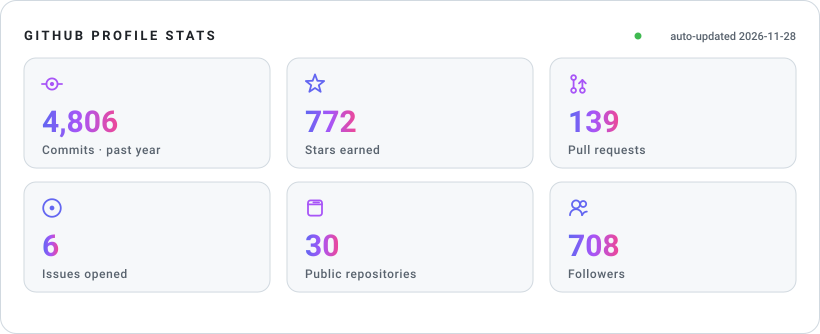

<!-- Animated banner — generated in this repository by GitHub Actions -->
<picture>
  <source media="(prefers-color-scheme: dark)" srcset="assets/header-banner-dark.svg">
  
</picture>

<!-- Rotating tagline -->
<picture>
  <source media="(prefers-color-scheme: dark)" srcset="assets/typing-ticker-dark.svg">
  
</picture>

I'm a simple developer with some experience and ideas.
I build **Android and multiplatform apps in Kotlin**

### Tech stack

### GitHub Stats

<picture>
  <source media="(prefers-color-scheme: dark)" srcset="assets/profile-stats-dark.svg">
  
</picture>

